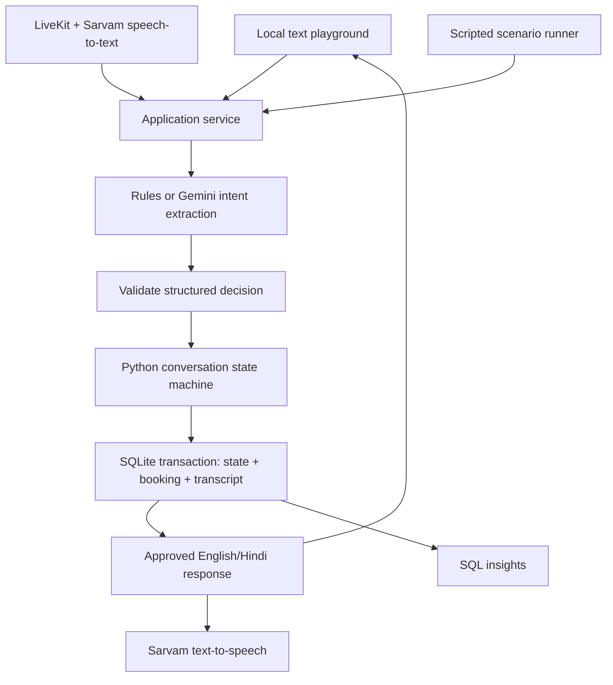

# Vaani — Bilingual Sales Voice Agent & Evaluation Lab

A portfolio project for English/Hindi conversation design, Python application logic, SQL analysis, and repeatable voice-agent evaluation. The campaign qualifies prospective customers for a **fictional Aster One electric-scooter test ride**.

**Status:** version 0.2 includes Voice Studio and saved-run comparisons. The text playground, booking policy, persistence, SQL dashboard, offline evaluations, voice-control logic, and saved-run comparisons are tested. Optional Gemini and LiveKit/Sarvam adapters are implemented and contract-tested, but **live model calls and real audio have not been tested** because no credentials were provided.

This project is not affiliated with SquadStack, LiveKit, Sarvam, or a real dealership. No telephone calls or real reservations are made. The offline baseline is a small rules parser, not an LLM.

## Start in one command

From this folder, with Python 3.11 or newer:

```sh
python3 -m vaani serve
```

Open http://127.0.0.1:8765. No installation, API key, or internet access is needed for the offline dashboard. Voice Studio requires the optional dependencies and accounts described below. If port 8765 is occupied, add `--port 8766`.

If you installed the optional dependencies in a virtual environment:

```sh
.venv/bin/python -m vaani serve
```

The server binds exclusively to localhost. Stop it with Ctrl+C. Your data persists in `data/vaani.sqlite3`. To start a separate sandbox without deleting anything:

```sh
python3 -m vaani serve --db data/another-demo.sqlite3 --port 8766
```

## A five-minute demo

1. Select **हिंदी / Hinglish**, then **New conversation**.
2. Use `हाँ` → `दिल्ली` → `एक लाख` → `इस महीने` → `1` → `हाँ बुक कर दो`.
3. Observe that selecting a slot does not book it. Only the subsequent confirmation creates a reservation.
4. Open another session and ask `discount milega?`, then `dobara call mat karna`.
5. Open **Evaluation suite**, run the offline suite, and expand a scenario transcript.
6. Open **SQL insights** to inspect session cohorts and the query used to calculate their demo booking rates.

The demo has two slots per city for the next day, at 11 AM and 4 PM in Asia/Kolkata. Each slot has capacity one. A competing booking or expired slot causes a recorded handoff outcome, not a fabricated confirmation. Handoffs are local flags, not actual transfers.

## What is implemented

- Consent → city → budget → purchase timeline → slot choice → explicit confirmation.
- English and Hindi response templates; a limited offline parser also recognizes selected Hinglish phrases and Devanagari numerals.
- Catalog-grounded answers for price and range; no invented discounts.
- Early opt-out, human-assistance requests, and escalation after three unclear turns.
- Corrections invalidate a pending slot and require a new selection/confirmation.
- A SQLite booking transaction with uniqueness constraints and request idempotency.
- Per-turn intent, state transition, planner status, and processing duration.
- Session history, SQL cohorts, evaluation results, and transcript inspection in the dashboard.
- 26 scripted text scenarios in isolated databases so evaluations do not inflate application metrics.
- Zero-shot and few-shot prompt variants for the optional Gemini interpreter.
- Browser Voice Studio: LiveKit connection, microphone controls, captions, speaking states, and provider setup checklist.
- Optional LiveKit worker using Sarvam STT/TTS and the same business service.
- Voice events, observed interruptions, and transcript-to-speaking timing percentiles with sample size.
- Saved evaluation-run comparisons using a fingerprint of the complete scenario suite.
- Automated backend, HTTP, provider-contract, and optional voice-contract tests; GitHub Actions configuration.

## Architecture



The LLM interprets an utterance into an intent and explicit fields; it does not write SQL, generate prices, or commit bookings. Responses come from reviewed bilingual templates. This sacrifices some conversational flexibility to make business behavior auditable. Schema validation cannot prove that a model understood a sentence correctly; live evaluations remain necessary.

## Source and original contribution

The voice lifecycle is adapted from the official [LiveKit Python starter](https://github.com/livekit-examples/agent-starter-python), using documented conversation hooks. This is **an original application using an open-source framework**, not a claim to have built LiveKit or a speech model. The starter repository has not been wholesale copied or represented as original work.

Original project code covers the campaign state machine, planner contract, bilingual catalog responses, transaction safeguards, evaluation suite, SQL analytics, local API, and dashboard. See [THIRD_PARTY.md](THIRD_PARTY.md) for upstream ownership and [docs/decision.md](docs/decision.md) for the JD mapping and project choice.

## Folder guide

```text
vaani/
  domain.py       Campaign state and deterministic rules
  planner.py      Offline parser, prompts, Gemini structured extraction
  service.py      Persistence, idempotency, booking transaction
  schema.sql      Five SQLite tables and constraints
  server.py       Local HTTP API and dashboard delivery
  evaluation.py   Isolated text scenario runner
  scenarios.json  Versioned expected outcomes
  voice.py        Optional LiveKit/Sarvam adapter
  static/         Browser dashboard, no external assets
tests/            Unit, HTTP, concurrency, and adapter contract tests
docs/             Design, evaluation evidence, learning milestones
.github/workflows/ci.yml
```

## Data model and SQL

`sessions` stores source, initial language, planner, prompt version, outcome, and current state. `turns` stores redacted input, reply, intent, transition, timing, and the cached idempotent response. `bookings` has unique constraints on `(city, slot)` and `session_id`. `eval_runs` stores scenario results separately. `voice_events` stores worker states, timing measurements, and interrupted replies.

```sql
SELECT language, source, planner,
       COUNT(*) AS sessions,
       SUM(outcome = 'booked') AS bookings,
       ROUND(100.0 * SUM(outcome = 'booked') / COUNT(*), 1) AS booking_pct
FROM sessions
GROUP BY language, source, planner;
```

The denominator includes all started sessions, including active and declined ones. Language cohorts use the initial language; a mid-conversation switch updates state but does not rewrite the cohort. Demo booking rate is not evidence of sales conversion. Timings measure text processing, not end-of-speech to audible response.

## Tests and evaluation

```sh
python3 -m unittest discover -s tests -v
python3 -m vaani evaluate --report docs/offline-evaluation.json
```

With optional dependencies installed, the same test command includes voice contract tests:

```sh
.venv/bin/python -m unittest discover -s tests -v
```

The development run passed **43 Python tests, 5 JavaScript voice-control tests, and 26/26 scripted scenarios**. Three voice tests and the JWT test are skipped in a dependency-free environment. They check SDK construction, token scope, and hook integration with mocked speech, not real STT/TTS. Gemini tests mock the provider response.

The committed [offline evaluation report](docs/offline-evaluation.json) includes per-turn transcripts and actual run results. It is a development regression set, not an independent held-out benchmark. The rules parser was built alongside these cases; its perfect score must not be advertised as 100% real-world accuracy.

## Optional Gemini understanding

Install into a virtual environment:

```sh
python3 -m venv .venv
.venv/bin/python -m pip install -e '.[voice]'
cp .env.example .env
```

Fill in `GEMINI_API_KEY` and a structured-output-capable `GEMINI_MODEL` available in your account. Keep `.env` private. The installed CLI reads it on startup; restart the server and choose Gemini when creating a session. Model requests send the current redacted utterance and conversation stage to Google. Common contiguous Indian phone numbers and email addresses are redacted, but this is not comprehensive PII detection. Use invented customer data.

To compare prompt variants on the same scenarios (these commands use paid inference according to your provider account):

```sh
.venv/bin/python -m vaani evaluate --planner gemini --prompt zero-shot-v1 --report data/gemini-zero.json
.venv/bin/python -m vaani evaluate --planner gemini --prompt few-shot-v2 --report data/gemini-few.json
```

No prompt improvement is claimed until these runs and human review occur. The dashboard has separate offline and Gemini buttons. Gemini requires configured credentials and an explicit paid-inference acknowledgement. There is no automatic provider retry: a timeout or malformed decision preserves the state, records a provider error, and asks the customer to retry.

## Optional live voice

Fill `SARVAM_API_KEY`. Set `VAANI_PLANNER=rules` for the offline interpreter, or configure the Gemini settings above for Gemini understanding. For a room-based LiveKit session, also fill `LIVEKIT_URL`, `LIVEKIT_API_KEY`, and `LIVEKIT_API_SECRET`.

```sh
.venv/bin/python -m vaani.voice download-files
.venv/bin/python -m vaani.voice console
```

Console mode uses your microphone and speaker. Room development mode:

```sh
.venv/bin/python -m vaani.voice dev
```

Open **Voice studio** in the dashboard. The checklist should show the required settings as configured. Select the language and planner, click **Start voice conversation**, and allow microphone access. The server issues a 10-minute token for one room and requests the named `vaani-sales` worker. The worker must run from the same folder with the same database and .env as the dashboard. Use **Mute microphone** or **End call** to control the session. If autoplay is blocked, click **Enable sound**.

Voice Studio streams audio through LiveKit and Sarvam. Gemini receives redacted transcripts when selected. The checklist verifies local configuration, not provider validity or worker availability. No microphone call has yet been made in development.

Captions come from LiveKit transcription events; committed transcripts and measurements are polled from the local database. Timing is measured from a committed transcript to the worker entering its speaking state. It excludes STT time, network delivery, and browser playback. The display reports nearest-rank percentiles over the whole session, with the sample size. End-to-end acoustic quality still needs real testing.

`VAANI_PLANNER=rules` permits testing speech transport without a Gemini key, but still needs Sarvam credentials and only understands the limited offline grammar. STT uses automatic language detection; TTS follows the current response language. Provider model availability, speech quality, interruptions, and end-to-end latency need live validation. Speculative generation is disabled to avoid booking from provisional transcripts.

## HTTP API

All routes are local. POSTs require the session-specific `X-Vaani-Token` from the page meta tag and reject foreign origins. This is CSRF protection, not user authentication.

| Method | Route | Purpose |
|---|---|---|
| GET | `/api/health` | Local health status |
| GET | `/api/overview` | Real local aggregates and latest evaluation |
| POST | `/api/sessions` | Create `{language, planner, version}` |
| GET | `/api/sessions/{id}` | State and chronological turns |
| POST | `/api/sessions/{id}/turns` | Submit `{text, request_id}` |
| POST | `/api/evaluations` | Run offline or explicitly acknowledged Gemini evaluation |
| GET | `/api/evaluations` | List saved runs |
| POST | `/api/evaluations/compare` | Compare `{baseline_id, candidate_id}` |
| GET | `/api/voice/status` | Boolean configuration checks; no credentials |
| POST | `/api/voice/connect` | Issue a room-scoped token and create a voice session |

Messages are limited to 2,000 characters and request bodies to 16 KB. A reused request ID with different text returns 409. A changed session during inference also returns 409. Unknown sessions return 404; bad inputs return 400; missing local token returns 403. Only explicit static paths are served.

## Deployment and limits

This milestone is a reproducible **local portfolio demo**, not a public production deployment. Run it with a normal Python interpreter, keep the SQLite file on local disk, and retain its localhost binding. The included CI config runs free checks only; it has not been run on GitHub yet.

For a later hosted version, replace the local HTTP server with an authenticated ASGI service, use PostgreSQL for shared bookings across workers, add rate limits and retention controls, and keep speech credentials on the server. No cloud platform is required by the JD, so those additions should follow working bilingual audio evaluation rather than precede it.

See [docs/milestones.md](docs/milestones.md) for the next learning steps and [docs/design.md](docs/design.md) for trade-offs and remaining risks.

## Version 0.2: compare experiments

Run the offline suite twice, click **Refresh runs**, and choose a baseline and candidate. Cases are labeled recovered, regressed, unchanged, or not comparable. The scenario-suite fingerprint covers inputs and expected outcomes, preventing a changed test set from masquerading as a prompt improvement. Legacy reports without a fingerprint are not comparable. The UI lists the latest 50 runs.

Gemini can be evaluated from the same screen after credentials are configured and paid inference is acknowledged. Each suite makes sequential model requests and may take several minutes. The server completes the run even if you close the page. Read the transcript of failed cases; the aggregate alone is not a causal claim about the prompt.

Run the frontend lifecycle checks with Node.js 20+:

```sh
node --test tests/client/voice-ui.test.cjs
```

These use a fake room and microphone to verify connection, mute, denied permission, cleanup, and cancellation. They do not prove real WebRTC or acoustic performance.

See [Voice Studio setup](docs/voice-setup.md). The existing text playground continues to work without credentials.
